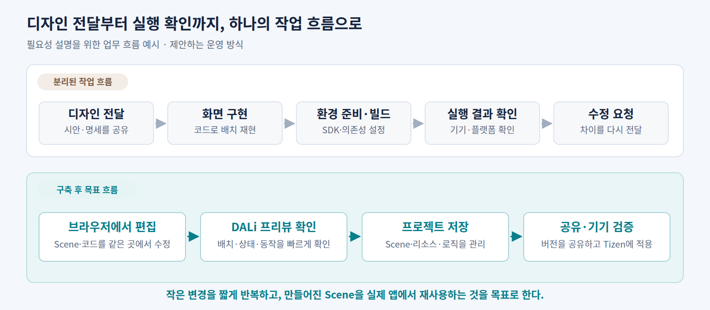
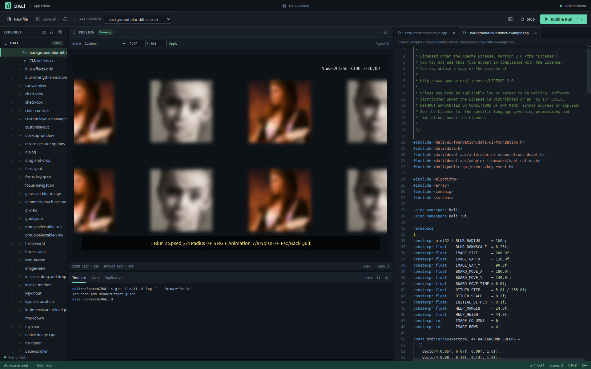
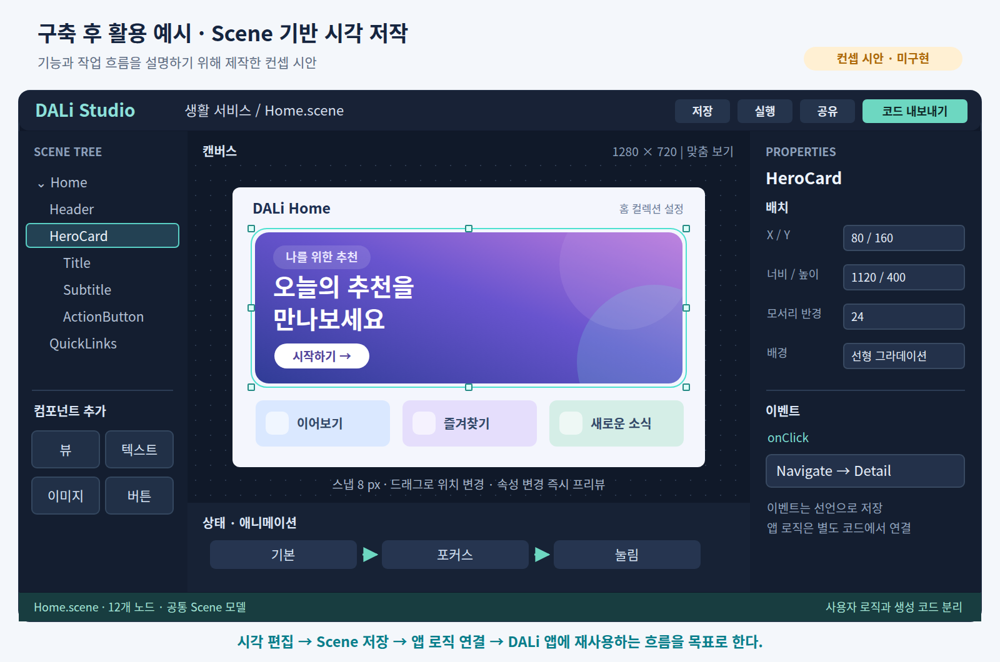
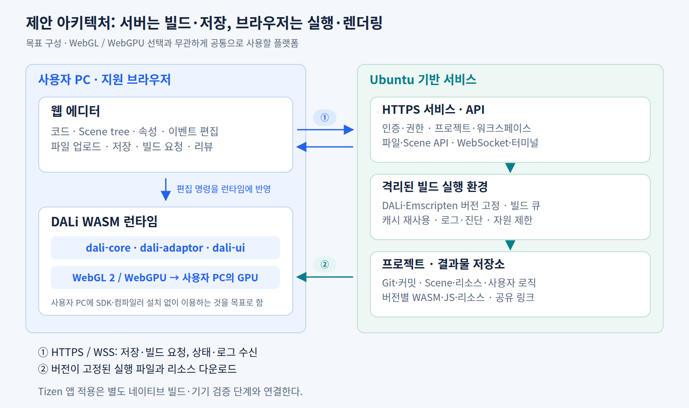
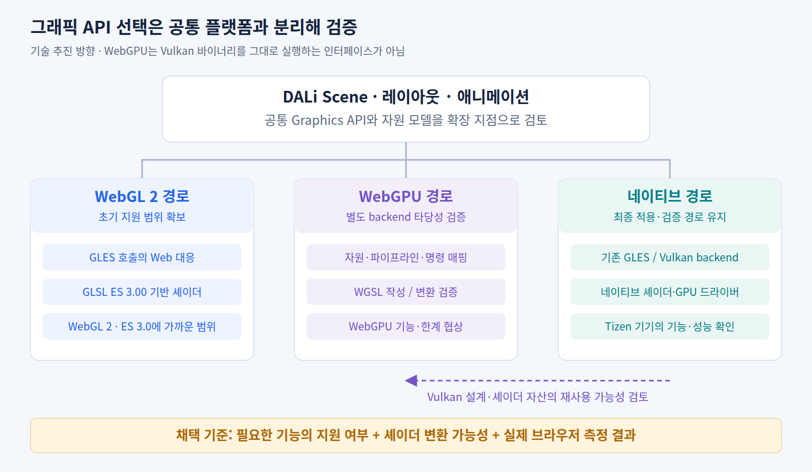

# Web 기반 DALi UI 개발·저작 공통 기반 구축 계획서

**액션 아이템 제안 · 2026-10-28 · 검토용 초안**

> **문서의 전제**
>
> 이 문서는 앞으로 수행할 개발 과제의 계획서다. 제품 기능은 모두 신규 구축 대상으로 가정한다. 지금까지의 실험은 기술 방향을 설명하기 위한 PoC로만 취급하며, 정식 개발도구·저작도구·서버 서비스의 구현 완료를 의미하지 않는다. 본문의 아키텍처와 저작 화면은 제안이며, 실제 캡처에는 PoC임을 별도로 표시했다.

## 액션 아이템 개요

| 항목 | 제안 내용 |
| --- | --- |
| 아이템명 | **Web 기반 DALi UI 개발·저작 공통 기반 구축** |
| 수행 내용 | DALi를 브라우저에서 실행할 수 있는 기반과 서버의 프로젝트·빌드 환경을 구축하고, 이를 코드 개발·시각 저작·리뷰에 함께 활용한다. |
| 대상 사용자 | DALi 앱 개발자, UI 디자이너, 플랫폼 개발자, 리뷰·검증 담당자 |
| 초기 활용 대상 | Tizen 앱을 위한 2D UI 구성·동작 확인·프로토타이핑 |
| 기본 구성 | Ubuntu 서버의 소스·리소스·빌드 관리 + 사용자 브라우저의 에디터·DALi WASM 실행 |
| 사용자 경험 | 지원 브라우저에서 HTTPS 주소에 접속해 작업한다. 사용자 PC에 DALi SDK·컴파일러를 별도로 설치하지 않는 사용 흐름을 목표로 한다. |
| 핵심 산출물 | Web 실행 기반, 서버 서비스, 공통 Scene 모델, 개발·저작 UI, 앱 재사용 경로, 지원 기능·검증 기준 |
| 그래픽 API 방침 | WebGL 2와 WebGPU의 적용 범위를 검증해 선택한다. 플랫폼 구축과 그래픽 backend 선정을 별도 과제로 관리한다. |

핵심은 **디자인을 전달받아 화면을 다시 구현하는 비용과, 수정 결과를 확인·공유하는 시간을 줄이는 것**이다. 이를 위해 브라우저에서 구성한 UI가 실제 DALi 앱의 Scene·리소스·코드로 이어지는 경로를 만들고자 한다.

## 1. 배경

DALi는 `dali-core`, `dali-adaptor`, `dali-ui`를 중심으로 Tizen의 UI framework를 구성하며, Ubuntu·Windows backend에서도 동작한다. 이 계획은 이러한 기존 DALi 자산을 Web 기반 작업 환경으로 확장하는 것을 대상으로 한다.

현재의 과제는 UI runtime의 기능을 제공하는 것에서 더 나아가, **사용자가 화면을 만들고 확인하는 과정까지 지원하는 것**이다. 본 과제의 출발 조건은 다음과 같다.

- 앱 개발자가 디자인을 적용하려면 코드로 뷰·배치·속성·동작을 구성하고, 빌드·실행을 통해 결과를 확인해야 한다.
- 디자이너가 실제 DALi 화면의 속성을 직접 바꾸고 동작을 확인할 수 있는 저작·프리뷰 환경이 필요하다.
- 개인별 SDK·외부 라이브러리·빌드 설정을 준비하는 작업이 새 사용자와 협업 참여자의 진입 부담이 될 수 있다.
- 코드나 정적인 시안과 함께, **특정 버전의 동작하는 화면**을 공유하고 재현할 수 있는 작업 단위가 필요하다.

위 내용은 이번 과제의 문제 가정이다. 착수 시 개발자·디자이너의 실제 작업 과정을 조사해 반복 비용과 우선 지원 시나리오를 확인한다.



*그림 1. 업무 흐름 개선의 목표. 현재 업무의 실측 결과가 아니라 문제와 추진 방향을 설명하기 위한 예시다.*

## 2. 필요성

### 2.1 디자인과 실제 UI 동작 사이의 반복을 줄일 필요

레이아웃, 간격, 텍스트, 이미지, 상태 색상처럼 작은 변경도 코드 수정과 결과 전달을 반복하게 되면 협업 주기가 길어진다. 시각 저작 기능을 통해 사용자가 값을 조정하고 DALi runtime의 결과를 바로 확인할 수 있도록 한다. 작업 결과는 앱 개발 단계에서 재사용할 수 있는 형식으로 남겨야 한다.

### 2.2 개발환경보다 작업 자체에 집중할 수 있는 진입점 필요

서버에 DALi·Emscripten·의존성·빌드 설정을 관리하고, 사용자는 브라우저로 접속하도록 한다. 개발자는 코드와 앱 로직에, 디자이너는 화면 구성과 상태 표현에 집중할 수 있는 공통 진입점을 제공한다.

여기서 “설치 없이 사용”은 **사용자 PC에 개발용 SDK와 컴파일러를 설치하지 않는다는 의미**다. 브라우저는 WASM과 리소스를 다운로드해 실행하며, 화면 처리에는 해당 PC의 CPU·GPU·메모리를 사용한다. 지원 브라우저와 네트워크 조건을 정의하는 작업이 필요하다.

### 2.3 같은 결과물을 기준으로 리뷰하고 재현할 필요

프로젝트, Scene, 리소스, 소스 커밋과 빌드 설정을 묶고 버전별 실행 주소를 제공한다. 리뷰 담당자가 화면을 직접 조작할 수 있게 하고, 문제가 발생한 버전의 결과물을 다시 열어볼 수 있도록 한다. 화면 공유와 문제 재현에 쓰는 기준을 일치시키는 것이 목적이다.

### 2.4 개발도구와 저작도구가 공유할 기반 필요

코드 에디터, 시각 저작기, 샘플 갤러리, UI 검증 화면은 서로 다른 사용자 경험을 갖지만, 프로젝트 관리·DALi 실행·리소스 로딩·입력 처리·결과 저장·버전 관리는 공유할 수 있다. 공통 기반을 먼저 정의해 같은 기능을 도구마다 다시 구현하는 비용을 줄인다.

## 3. 목적과 추진 원칙

**목적은 Web에서 DALi UI를 편집·실행·저장·공유하고, 그 결과를 Tizen 앱 개발에 재사용할 수 있는 공통 작업 기반을 만드는 것이다.**

이를 위해 다음 원칙을 적용한다.

1. **실제 DALi runtime을 프리뷰의 기준으로 삼는다.** 브라우저 UI는 편집과 조작을 담당하고, 대상 UI의 실행은 DALi WASM runtime으로 연결한다.
2. **사용자가 만든 Scene을 앱에서 재사용하도록 한다.** 저작 문서, 생성 코드, 사용자 로직의 관계를 먼저 정의한다.
3. **코드 개발과 시각 저작이 같은 프로젝트를 사용하도록 한다.** 초기 화면 형태는 달라도 프로젝트·리소스·실행 기반을 공유한다.
4. **플랫폼 지원 범위를 명시한다.** 지원하지 않는 기능은 사용자에게 알리고, 브라우저 프리뷰와 Tizen 기기 검증의 역할을 구분한다.
5. **기존 backend를 보호한다.** Web 전용 구현·빌드 설정을 격리하고, 공통 API 변경 시 기존 backend의 회귀 검증을 완료 조건에 포함한다.

### 대표 사용 시나리오

| 사용자 | 구축 후 목표 작업 |
| --- | --- |
| 디자이너 | 주소 접속 → 프로젝트 열기 → 뷰 배치·속성·상태 조정 → 프리뷰 확인 → Scene 저장·리뷰 요청 |
| 앱 개발자 | 프로젝트 열기 → C++ 로직 편집 → 서버 빌드 → 브라우저 실행 → 이벤트 연결 → Tizen 앱 적용 |
| 리뷰 담당자 | 버전이 고정된 링크 열기 → 클릭·키 입력·화면 전환 확인 → 같은 버전에 의견 전달 |
| 플랫폼 개발자 | 같은 샘플·Scene으로 runtime 변경 전후 비교 → 오류·지원 차이 확인 → 회귀 검증 |

## 4. 구체적으로 무엇을 구축하는가

### 4.1 Web용 DALi 실행 기반

`dali-core`, `dali-adaptor`, `dali-ui`를 WebAssembly로 빌드하고 브라우저에서 실행하는 경로를 정식 개발 대상으로 정의한다. 단순히 빌드 성공 여부를 확인하는 수준을 넘어 다음 항목을 확보한다.

- 애플리케이션 초기화·종료, 브라우저 이벤트 루프와 DALi 스레드 구성, 예외·오류 전달
- canvas surface, 마우스·키보드 입력, 논리 Scene 크기와 실제 표시 영역의 좌표 변환
- 텍스트·폰트·이미지·리소스 로딩과 2D 렌더링, clipping·mask·render effect 등의 지원 범위
- 편집 UI에서 DALi 객체를 선택·생성·삭제·수정할 수 있는 Web 편집 API
- context/device loss, 메모리 부족, 기능 미지원에 대한 감지·안내·복구 정책
- 버전이 고정된 빌드 구성과 실행·호환성 테스트 묶음

편집 API는 안정적인 노드 ID와 변경 명령을 기준으로 설계한다. 명령의 순서, 배치 처리, Undo/Redo, 편집 문서와 실행 Scene 사이의 동기화 책임도 함께 정의한다.

### 4.2 Web 개발도구 경험

코드 중심 작업에서는 Explorer, 코드 편집, DALi 프리뷰, 터미널, 빌드·앱 로그를 연결한다.

- 프로젝트·샘플 선택, 소스·리소스 탐색과 저장
- 코드 편집, 컴파일 진단과 오류 위치 이동
- 서버의 빌드 요청·진행·취소와 성공 결과 실행
- 빌드가 실패해도 마지막 정상 프리뷰를 확인할 수 있는 동작
- 프로젝트별 실행 환경과 버전 정보를 사용자가 확인할 수 있는 표시



*그림 2. 방향 설명을 위한 실제 PoC 참고 화면. `background-blur-dither` 샘플을 브라우저에서 실행해 캡처했다. 정식 개발도구가 구축되었다는 의미가 아니며, 향후 제품 UI·기능 범위는 별도로 설계한다. 촬영 시 키 입력으로 blur 반경을 조절했으며 소스 파일은 수정하지 않았다.*

프리뷰가 단순한 화면 이미지에 머무르지 않도록, 효과·상태·입력이 실제로 동작하는 샘플을 검증 항목으로 선정한다. `background-blur-dither`와 같은 다중 패스 효과 샘플은 기능 대응과 렌더링 차이를 검증하는 후보로 활용한다. 노이즈 처리의 정확도나 GPU 성능은 별도 검증 항목으로 둔다.

### 4.3 Scene 기반 시각 저작 경험

저작 모드에서는 화면의 구조·값·동작을 직접 편집할 수 있게 한다.

| 영역 | 개발할 기능 |
| --- | --- |
| Scene tree | 계층·선택·표시 순서·그룹·부모 변경, 노드의 안정적인 ID 관리 |
| 캔버스 | 뷰 추가, 드래그 이동, 크기 변경, 선택 표시, 정렬·스냅, 논리 해상도 설정 |
| 속성 편집 | 위치·크기·레이아웃·색상·텍스트·이미지·효과의 편집과 즉시 반영 |
| 상태·동작 | 기본·포커스·눌림 등의 상태, 속성 전환과 기본 애니메이션 |
| 이벤트 | 클릭·입력과 화면 이동·속성 변경·애니메이션·앱 핸들러의 연결 |
| 편집 관리 | Undo/Redo, 복사·붙여넣기, 저장·재열기, 스키마 버전 관리 |

일반적인 속성·배치 변경은 브라우저의 편집 API로 runtime에 반영하는 흐름을 목표로 한다. C++ 로직 변경이나 새 기능 추가는 서버 빌드 경로로 처리한다. 저작 작업마다 전체 C++ 빌드를 반복하지 않도록 변경 유형을 구분한다.



*그림 3. 구축 후 활용을 가정한 저작도구 컨셉 시안. 본 계획서를 위해 제작한 설명용 이미지이며 실제 구현 화면이 아니다.*

### 4.4 공통 Scene 모델과 앱 재사용 경로

저작기의 핵심 산출물은 화면의 스크린샷이 아니라 **Scene의 구조와 값, 리소스 참조, 이벤트·동작 선언을 포함한 프로젝트**로 정의한다.

프로젝트 구조의 예시는 다음과 같다. 파일명·스키마·API는 착수 단계에서 설계할 대상이다.

```text
project/
  project.json                 # DALi·도구 버전, 대상 플랫폼, 빌드 설정
  scenes/Home.scene.json       # 노드·레이아웃·속성·상태·이벤트 선언
  assets/                     # 이미지·폰트·기타 리소스
  src/handlers.cpp            # 개발자가 작성하는 앱 로직
  generated/HomeScene.cpp     # 필요 시 생성하는 Scene 구성 코드
```

이벤트는 우선 `onClick → 화면 이동`, `onClick → 애니메이션 실행`, `onClick → 이름이 정해진 앱 핸들러 호출`처럼 선언 가능한 범위를 정의한다. 임의의 C++ 비즈니스 로직을 시각적으로 전부 표현하는 기능은 초기 범위에서 제외한다.

재사용 경로는 다음 두 후보를 검증해 결정한다.

| 방식 | 내용 | 결정 시 확인할 사항 |
| --- | --- | --- |
| Scene runtime loader | 저장한 Scene 문서를 Web·네이티브 DALi 앱에서 읽어 구성 | 지원 컴포넌트·스키마 버전·로딩 시간·앱 배포 크기 |
| C++ 코드 생성 | Scene 구성 코드와 이벤트 연결 코드를 생성하고 사용자 로직과 연결 | 생성 결과의 재현성·사용자 코드 보존·리소스 패키징·앱 빌드 연동 |

초기에는 Scene 문서를 시각 편집의 기준 데이터로 삼고 사용자 로직과 생성 코드를 분리한다. **임의로 수정한 모든 C++ 코드를 다시 Scene tree로 복원하는 양방향 변환은 초기 완료 조건에 포함하지 않는다.** 일반 C++ 앱 편집과 Scene 저작이 각각 어떤 파일을 관리하는지 명확히 한다.

### 4.5 서버·클라이언트 서비스 기반



*그림 4. 구축할 서비스의 목표 구성. 단일 서버에서 시작하되 API·빌드 작업·결과물 저장의 책임을 구분한다.*

서버는 프로젝트·소스·리소스를 보관하고 빌드를 실행한다. 브라우저는 편집 UI와 DALi WASM 앱을 실행한다. 매 프레임의 화면을 서버가 만들어 영상으로 전송하는 방식은 기본 구조로 채택하지 않는다.

구축 과제는 다음과 같다.

- **접속·권한:** 신뢰할 수 있는 HTTPS 주소, 로그인, 프로젝트별 접근 권한, 공유 링크의 범위와 만료 정책
- **프로젝트 관리:** 생성·업로드·Git 연동·리소스 저장·버전 고정·내보내기
- **빌드 실행:** 작업 큐, 동시 실행 수, 취소, 로그·진단, 의존성 캐시, 도구 버전 고정
- **작업 격리:** 사용자·프로젝트별 파일·프로세스·터미널·빌드 결과 분리, 실행 계정과 자원 제한
- **배포·운영:** 서비스 버전과 사용자 앱 버전의 분리, 정상 빌드 결과 보존, 저장 용량·보관 기간·장애 대응
- **브라우저 진단:** 필요한 API·스레드·GPU 기능을 접속 시 확인하고, 실행할 수 없는 조건을 빈 프리뷰 대신 설명

클라이언트 PC의 파일은 브라우저 접속만으로 서버에 자동 연결되지 않는다. 업로드·다운로드·Git 동기화를 기본 경로로 정의하고, 필요하면 공유 디렉터리 연동을 별도 검토한다.

현재 PoC에서 사용하는 것과 같은 WASM pthreads 구성은 HTTPS 등 보안 컨텍스트와 cross-origin isolation이 필요하다. 서비스 배포에는 COOP/COEP 및 프리뷰 iframe의 권한·origin 설정을 포함해 검증한다. [Emscripten pthreads 문서](https://emscripten.org/docs/porting/pthreads.html), [SharedArrayBuffer 실행 조건](https://developer.mozilla.org/en-US/docs/Web/JavaScript/Reference/Global_Objects/SharedArrayBuffer)

### 4.6 Git·CI와 연동한 지속 배포

DALi 버전과 Web 도구의 변경을 재현 가능한 배포로 연결한다.

```text
소스 변경
  → 고정된 툴체인으로 core → adaptor → ui → 테스트 앱 빌드
  → 브라우저 기능·입력·시각 회귀 검사
  → 영향받는 네이티브 backend 회귀 검사
  → 버전 정보와 실행 결과물 저장
  → 검증된 서비스·프리뷰 버전 배포
```

서비스 업데이트가 기존 프로젝트의 DALi 버전이나 이미 공유한 실행 결과를 자동으로 바꾸지 않도록 한다. 소스 커밋·의존성·빌드 옵션·리소스 버전을 기록하고, 사용자가 필요한 시점에 프로젝트 버전을 올릴 수 있게 한다.

## 5. 그래픽 기술 검토: WebGL 2와 WebGPU

### 5.1 판단의 출발점

**WASM 사용이 WebGL 사용을 뜻하지는 않는다.** WASM은 DALi C++ 코드를 브라우저에서 실행하는 수단이고, WebGL 2 또는 WebGPU는 GPU에 렌더링·연산을 요청하는 API다. Web 기반 공통 플랫폼의 구축 여부와 그래픽 backend 선택을 분리해서 판단한다.

WebGL 2는 OpenGL ES 3.0에 가까운 API와 GLSL ES 3.00을 제공하지만 Web 환경을 위한 차이·제약이 있다. GLES 3.1·3.2 전체 기능을 제공하는 것으로 해석하지 않는다. [Khronos WebGL 2 명세](https://registry.khronos.org/webgl/specs/latest/2.0/)

WebGPU는 명시적인 파이프라인·명령 제출·자원 관리와 compute를 제공하는 별도의 Web API다. Vulkan·Metal·Direct3D 계열 구현을 고려한 모델이지만 네이티브 API의 모든 기능을 노출하는 것은 목표가 아니다. 따라서 **“Vulkan backend가 있으므로 WebGPU로 그대로 실행할 수 있다”거나 “모든 기능이 자동으로 더 잘 지원된다”는 전제를 두지 않는다.** [GPU for the Web의 설계 설명](https://gpuweb.github.io/gpuweb/explainer/)

### 5.2 요구 기능별 검토 관점

| 요구 | WebGL 2 경로 | WebGPU 경로 | 본 과제의 확인 사항 |
| --- | --- | --- | --- |
| 기본 2D·텍스트·이미지 | 기존 GLES 경로와의 대응을 검토하기 쉬움 | 동일한 UI 기능을 별도 매핑해야 함 | 폰트·혼합·clip·mask·입력 결과 비교 |
| blur·다중 패스 효과 | framebuffer와 draw pass 조합으로 구현 가능 | render pass·texture·pipeline으로 구현 가능 | 효과별 출력·메모리·프레임 시간 측정 |
| 일반 GPU compute | core API에서 compute shader를 제공하지 않음 | compute shader·storage 자원 활용 가능 | DALi 공통 그래픽 계층과 효과 구현도 이를 사용할 수 있는지 확인 |
| 대량 객체·복잡한 3D | 3D 자체는 가능하며 API·자원 한계 검토 필요 | 고급 자원·명령 모델 활용 여지가 있음 | DALi에서 필요한 기능과 실제 3D Scene으로 별도 검증 |
| 기존 셰이더 자산 | GLES·GLSL ES와의 호환성 검토 | WGSL 대응·변환·검증 경로 필요 | 자동 생성 셰이더와 커스텀 셰이더를 모두 포함 |
| 네이티브 창·IME·plugin 등 | 별도 Web 대응 필요 | 별도 Web 대응 필요 | GPU API 선택과 분리한 플랫폼 기능 목록 관리 |

표의 API 특성은 [WebGL 2 명세](https://registry.khronos.org/webgl/specs/latest/2.0/), [WebGPU 설계 설명](https://gpuweb.github.io/gpuweb/explainer/), [WGSL 명세](https://www.w3.org/TR/WGSL/)를 기준으로 정리했다. DALi의 개별 기능 지원 여부와 성능은 이 과제에서 검증할 대상이다.

WebGPU가 기능 범위를 넓힐 수 있는 지점은 compute와 현대적인 GPU 자원·명령 모델이다. 다만 2D UI 요구를 두 경로에서 모두 충족할 수 있는 항목에서는 결과 품질·안정성·개발 비용을 함께 비교해야 한다. API 자체의 가능성과 DALi 구현의 완성도는 구분한다.

### 5.3 DALi Vulkan 자산을 어떻게 활용할 것인가

DALi의 그래픽 추상화, Vulkan의 자원·pipeline·command 구성 경험, 셰이더 처리 자산을 WebGPU backend 설계에 활용하는 방안을 검토한다. 브라우저의 GPU 구현이 내부적으로 Vulkan을 사용하는 경우에도, 애플리케이션이 호출하는 API는 WebGPU이므로 별도 연결 계층이 필요하다. [Dawn의 구성과 native backend](https://dawn.googlesource.com/dawn/+/refs/heads/main/README.md)

검토할 주요 작업은 다음과 같다.

1. DALi Graphics API의 buffer·texture·sampler·pipeline·render pass·command를 WebGPU 개념에 매핑한다.
2. 기존 GLSL·SPIR-V 자산에서 WGSL을 작성·생성·변환하는 후보 경로를 검증한다. browser WebGPU의 셰이더 입력은 WGSL을 기준으로 설계한다.
3. uniform 배치·바인딩·정렬, 좌표·깊이 범위, 텍스처 형식·샘플링·혼합을 점검한다.
4. 비동기 초기화, 스레드 소유권, 명령 제출과 resource lifetime, 오류·device loss 처리 방식을 설계한다.
5. 프레임 시간과 메모리뿐 아니라 셰이더 변환 성공률·시각 결과·브라우저 지원 조건을 함께 비교한다.

WGSL과 셰이더 단계는 [WGSL 명세](https://www.w3.org/TR/WGSL/)를 기준으로 확인한다. Tint의 SPIR-V reader·WGSL writer는 변환 후보로 조사하되, 임의의 DALi 셰이더가 모두 변환된다고 가정하지 않는다. [Dawn 빌드 구성의 reader·writer 옵션](https://github.com/google/dawn/blob/main/CMakeLists.txt)

C/C++에서 WebGPU를 연결하는 후보로 Emscripten의 Emdawnwebgpu를 검토한다. 이는 브라우저의 WebGPU API 위에 `webgpu.h` 계층을 제공하는 방식이다. 도입할 Emscripten·바인딩 버전을 고정하고 호환성을 검증한다. 기존 PoC의 툴체인에 옵션 하나를 더하는 것으로 완료된다고 가정하지 않는다. [Emscripten WebGPU 문서](https://emscripten.org/docs/porting/multimedia_and_graphics/WebGPU-support.html), [Emdawnwebgpu 문서](https://dawn.googlesource.com/dawn/+/refs/heads/main/src/emdawnwebgpu/pkg/README.md)



*그림 5. 그래픽 기술의 검토 경로. WebGPU 구현·채택은 앞으로 검증할 과제이며 세 경로의 지원 기능이 같다는 의미가 아니다.*

### 5.4 제안하는 선정 절차

초기에는 WebGL 2로 확보할 수 있는 2D 지원 범위를 확인하면서, WebGPU의 최소 실행·셰이더·자원 매핑을 병행 검증한다. 텍스트·이미지·clipping·blur·대량 노드·대표 3D Scene을 공통 시험 대상으로 삼아 backend를 결정한다.

WebGPU의 채택 조건은 **필요한 기능의 추가 지원 또는 측정 가능한 이득이 이식·유지 비용을 정당화하는지**다. WebGL에서 충족하기 어려운 필수 기능이 확인되면 WebGPU 우선순위를 높인다. 브라우저별 지원은 OS 이름만으로 판단하지 않고, 실제 browser·GPU·driver 조합의 기능·한계와 실행 결과를 기록한다. [WebGPU API와 호환성 참고](https://developer.mozilla.org/en-US/docs/Web/API/WebGPU_API)

fallback은 해당 Scene의 필수 기능을 충족할 때만 제공한다. WebGPU 전용 compute 등의 기능을 쓰는 Scene을 WebGL에서 동일하게 실행할 수 있다고 표시하지 않는다. DALi Vulkan backend의 존재나 WebGPU API의 기능만으로 3D 지원이 검증되었다고 판단하지 않는다.

## 6. 기대 효과와 효과 검증 방법

| 기대 이득 | 이득이 발생하는 이유 | 확인할 지표 |
| --- | --- | --- |
| 사용자 진입 부담 감소 | SDK·컴파일러·공통 빌드 환경을 서버에서 관리 | 최초 접속부터 첫 정상 화면까지의 시간, 지원 요청 건수 |
| 디자인 적용 주기 단축 | 배치·속성 조정과 DALi 프리뷰를 연결 | 동일 수정 과제의 완료 시간, 수정·확인 왕복 횟수 |
| 화면 재구현 작업 감소 | Scene·리소스·이벤트 선언을 실제 앱에 재사용 | 저작 결과를 앱에서 다시 구현한 항목 수, 적용 시간 |
| 리뷰·문제 재현 개선 | 커밋·리소스·설정·실행 결과를 버전으로 공유 | 리뷰 준비 시간, 재현 성공률, 환경 차이 관련 문의 |
| 개발환경의 일관성 향상 | 서버 툴체인과 의존성을 고정 | 동일 입력의 빌드 재현율, 환경 원인의 실패 건수 |
| 공통 도구 자산 확보 | 개발·저작·샘플·검증이 같은 기반을 사용 | 신규 기능을 도구 간 재사용한 범위, 유지보수 중복 작업 |

위 항목은 **기대 효과이며 달성 실적이 아니다.** 절감률·생산성 향상 배수는 시범 사용 전에 확정하지 않는다. 기존 방식과 같은 과제—뷰 추가, 텍스트·색상 변경, 이벤트 연결, 리뷰 전달, Tizen 앱 적용—를 수행해 기준선과 개선치를 비교한다.

서버 측에는 빌드 대기·캐시·저장 공간의 운영 비용이 추가된다. 클라이언트에는 WASM·폰트·리소스 다운로드와 렌더링 비용이 남는다. 빌드 시간의 cold/warm 조건, 최초 다운로드와 재방문 조건, 평균과 p95를 구분해 측정하고 전체 작업 시간으로 효과를 평가한다.

## 7. 단계별 수행 계획과 완료 기준

일정과 투입 인력은 요구 기능 목록 및 기술 검증 결과에 따라 산정한다. 아래 단계는 달력상의 확정 일정이 아니라 **판단 관문과 산출물**을 정의한 것이다.

| 단계 | 주요 작업 | 산출물 | 다음 단계 진입 기준 |
| --- | --- | --- | --- |
| A. 요구·기술 검증 | 사용자 시나리오·컴포넌트·플랫폼 기능 목록, WebGL/WebGPU 시험, Scene·export 후보 설계 | 요구·지원 matrix, 그래픽 비교 결과, 아키텍처·스키마 초안 | 필수 기능과 미지원 항목, 초기 backend·재사용 경로를 설명할 수 있음 |
| B. 실행·개발 공통 기반 | Web runtime 정식화, 코드·파일·빌드·프리뷰·오류 흐름, 버전 고정 | 재현 가능한 SDK·빌드, 개발도구 MVP, 검증 앱 | 새 환경에서 정해진 절차로 편집→빌드→실행을 재현하고 실패·취소 처리 확인 |
| C. 서버 서비스 | HTTPS·로그인·프로젝트 권한, 빌드 큐·작업 격리, 저장·버전·공유 | 단일 서버 기반 시범 서비스, 배포·운영 절차 | 다른 PC의 지원 브라우저에서 추가 SDK 설치 없이 사용하고 프로젝트 간 접근·작업 격리 확인 |
| D. Scene 저작·앱 재사용 | tree·배치·속성·기본 상태·이벤트·Undo/Redo, 저장·재열기, loader/export | 저작 MVP, 공통 Scene 모델, 예제 앱 | 시각 편집한 화면을 저장·재열기하고 사용자 로직을 유지한 채 Tizen 앱에 적용 |
| E. 시범 운영·개선 | 개발자·디자이너·리뷰 담당자의 실제 과제, 지원·성능·시각 회귀 시험 | 효과 측정 결과, 지원 범위표, 후속 확대 계획 | 기대 효과와 비용을 같은 과제로 비교하고 정식 운영 범위 결정 |

WebGPU 기술 검증은 A 단계에서 시작한다. 채택이 결정되면 B~E 단계의 같은 완료 기준으로 검증하며, backend 전환이 Scene 모델·프로젝트 계약을 불필요하게 바꾸지 않도록 한다.

### 우선 완료 조건안

- **개발 흐름:** 파일 수정·저장 → 서버 빌드 → 브라우저 프리뷰를 재현하고 오류·취소·정상 결과 보존을 확인한다.
- **설치 없는 접속:** 별도 DALi SDK를 설치하지 않은 PC에서 로그인·프로젝트 열기·실행을 확인한다. 지원 OS·browser·GPU 조합은 합의한 matrix로 관리한다.
- **저작 흐름:** 우선 선정한 View·Label·Image·Button·컨테이너 등 기본 구성의 추가·이동·속성·계층·Undo/Redo를 지원한다. 각 컴포넌트의 세부 범위는 A 단계에서 확정한다.
- **저장·재사용:** 노드 ID·계층·속성·리소스·이벤트를 저장 후 복원하고, 생성 결과의 앱 적용과 사용자 코드 보존을 확인한다.
- **렌더링 검증:** 대표 샘플의 입력·효과·크기 변경과 native/Web 간 시각 차이를 검사한다. 글꼴·해상도·색상 조건을 고정하고 허용 차이를 정의한다.
- **기존 backend 보호:** 공통 변경에 대해 Ubuntu·Windows·Tizen 및 해당 GLES/Vulkan 경로의 영향 범위를 정하고 빌드·실행 회귀 검증을 수행한다.

## 8. 범위와 운영상 고려사항

### 초기 범위에 포함할 것

2D UI, 선정한 기본 컴포넌트, 코드 편집·빌드·프리뷰, Scene 시각 편집, 프로젝트 저장·버전·공유, 앱 재사용 경로, 단일 서버 시범 운영, 지원 기능 안내와 회귀 검증을 중심으로 한다.

### 별도 확장으로 관리할 것

임의 C++의 완전한 시각 역변환, 모든 DALi 컴포넌트·동적 plugin의 Web 지원, 모든 3D 기능, OS 전용 창·미디어·IME 기능의 완전한 대응, 동시 공동 편집, 네이티브 수준 디버거, 외부 디자인 도구와의 완전한 호환은 단계별 확장으로 관리한다.

### 반드시 구분할 경계

| 경계 | 계획에 반영할 처리 |
| --- | --- |
| Web과 Tizen의 출력·기능 차이 | 브라우저에서 빠르게 구성·검증하고, 최종 폰트·성능·플랫폼 기능은 Tizen 기기에서 확인하는 흐름을 제공 |
| GPU API와 플랫폼 기능 | WebGPU 전환이 native window·IME·plugin 지원까지 자동으로 해결한다고 가정하지 않음 |
| 코드 실행 서비스의 권한 | 빌드·터미널·앱 로직이 실행되는 환경을 사용자·프로젝트 기준으로 격리 |
| Scene 저작과 앱 로직 | 문서·생성 코드·사용자 코드의 소유권과 변경 방향을 정의 |
| 서비스와 프로젝트의 버전 | 서비스 업데이트와 사용자 프로젝트의 runtime·리소스 버전을 분리 |
| 서버 처리와 사용자 PC 처리 | 빌드·저장은 서버, 편집 UI·WASM 렌더링은 클라이언트가 담당하도록 요구 성능과 용량을 각각 산정 |

## 9. 착수 시 결정할 사항

1. 개발자·디자이너·리뷰 담당자가 우선 해결할 대표 과제와 초기 사용자 범위
2. 첫 출시에서 지원할 컴포넌트·효과·입력·브라우저·OS·GPU의 최소 조합
3. WebGL 2·WebGPU 평가 항목과 backend 채택 관문
4. Scene 문서의 기준 데이터, 이벤트 선언 범위, runtime loader와 코드 생성의 우선순위
5. 서버 인증·프로젝트 분리·Git·빌드 실행·결과물 보관의 운영 책임
6. Tizen 앱 적용 경로와 기기 검증 책임, 기존 backend 회귀 검증 범위
7. 시범 사용의 기준선·효과 지표, 인력·일정·운영 비용 산정

## 참고 자료와 시각 자료 안내

외부 기술 자료 확인일은 **2026-10-28**이다. 개발 시 도입할 버전의 명세·툴체인·지원 조건을 다시 고정한다. 공식 자료의 일반 기능 설명을 DALi 제품 기능이나 검증 완료 실적으로 해석하지 않는다.

| 자료 | 이 문서에서 확인한 내용 |
| --- | --- |
| [Khronos WebGL 2 명세](https://registry.khronos.org/webgl/specs/latest/2.0/) | GLES 3.0과의 관계, GLSL ES 3.00, WebGL 제약 |
| [GPU for the Web: WebGPU Explainer](https://gpuweb.github.io/gpuweb/explainer/) | GPU compute, 자원·명령 모델, optional features·limits, 네이티브 API 전체 노출을 목표로 하지 않는 점 |
| [W3C WGSL 명세](https://www.w3.org/TR/WGSL/) | WebGPU 셰이더 언어, vertex·fragment·compute 단계 |
| [Dawn README](https://dawn.googlesource.com/dawn/+/refs/heads/main/README.md) | WebGPU 구현 계층과 native backend, Tint |
| [Dawn CMake 구성](https://github.com/google/dawn/blob/main/CMakeLists.txt) | SPIR-V reader와 WGSL writer 등 변환 후보의 구성 옵션 |
| [Emscripten WebGPU 문서](https://emscripten.org/docs/porting/multimedia_and_graphics/WebGPU-support.html), [Emdawnwebgpu](https://dawn.googlesource.com/dawn/+/refs/heads/main/src/emdawnwebgpu/pkg/README.md) | 브라우저 WebGPU를 연결하는 C/C++ 바인딩 후보 |
| [Emscripten pthreads](https://emscripten.org/docs/porting/pthreads.html), [SharedArrayBuffer](https://developer.mozilla.org/en-US/docs/Web/JavaScript/Reference/Global_Objects/SharedArrayBuffer) | 멀티스레드 실행과 보안·배포 조건 |
| [MDN WebGPU API](https://developer.mozilla.org/en-US/docs/Web/API/WebGPU_API) | 지원 환경·보안 컨텍스트·기능 확인 참고 |

PoC 화면은 DALi 작업 공간의 실제 샘플로 촬영했다. 도식과 저작 화면 시안은 본 계획서를 위해 직접 제작했으며 외부 제품 화면을 사용하지 않았다. 그림은 Markdown 뷰어 호환성을 위해 PNG로 삽입했고, 직접 제작한 도식의 편집 가능한 SVG 원본도 함께 보관했다.

| 리소스 | 구분 |
| --- | --- |
| `resources/01-workflow.{png,svg}` | 업무 흐름 개선 목표 도식 |
| `resources/02-editor-poc.png` | `background-blur-dither`의 실제 PoC 참고 캡처 |
| `resources/02-preview-blur.png`, `02-preview-clear.png` | 같은 PoC의 blur 표시·해제 참고 캡처 |
| `resources/03-authoring-concept.{png,svg}` | 구축 후 활용을 설명하는 미구현 저작 화면 시안 |
| `resources/04-architecture.{png,svg}` | 목표 서버·클라이언트 구조 |
| `resources/05-backend-strategy.{png,svg}` | 그래픽 API 검토·확장 경로 |
| `resources/capture-metadata.json` | 캡처 조건·소스 해시·PoC 입력 확인 기록 |
| `resources/capture-editor.mjs`, `make-figures.py`, `render-figures.mjs` | 캡처·도식 생성·PNG 렌더링 재현용 스크립트 |

로컬 PoC의 빌드·실행 방법은 상위 폴더의 [WEB_BUILD_GUIDE.md](../WEB_BUILD_GUIDE.md)를 참고할 수 있다. 해당 가이드는 실험 환경 안내이며 본 계획의 정식 제품 완료 조건과는 별도로 관리한다.
